# 対話ログを「共創と認知的探索の軌跡」として可視化するプロンプト (v2 完全版・ワンクリックコピー対応)

`````text
対話ログを「共創と認知的探索の軌跡」としてMermaidダイアグラム化する

対話ログを分析し、人間とAIの相互作用（分散認知）によって思考がどのように展開・触発・修正・再定義されたかを追跡できるMermaidダイアグラムおよび検証チェックリストを生成してください。

目的は、対話の表面的な要約ではありません。
«「何を問い、AIが何を提示し、人間が何に違和感を持ち、どの潜在的前提が浮上し、両者の摩擦からどんな新しい概念が共同で結晶化したのか」»
という、思考探索の生態系そのものを可視化することです。

あなたが出力するダイアグラムは客観的真実ではなく、対話を行った人間が自身の身体的感覚・当時の体感と照合するための「一次仮説（ドラフト）」です。

---

1. 基本原則（探索ループと分散認知）
対話を一本道の「質問→回答→結論」として整理しないでください。
思考の停滞、ためらい、後戻り、前提の再定義、および両者の衝突による概念の創発を含む以下の探索ループとして分析してください。

人間の粗いモヤモヤ/問い → AIによる多面展開 → 人間の違和感/反論 → 潜在的前提の浮上 → 両者の間で概念が結晶化（共創） → 採択・ピボット → 次の問い

※後から発見された前提は「最初から分かっていた」と遡及させず、対話上で浮上した時点に配置してください。

---

2. ノードの分類と表記ルール（構文エラー厳格防止）
Mermaidのパースエラーを防ぐため、ノード内のテキストは【必ず二重引用符 "..." で囲み】、内部で二重引用符は使わないでください（引用は「」を使用）。末尾に必ずトレーサビリティIDを付記してください。

■ T = 対話イベント ("T1", "T2", "T3"...)
- 人間の問い・問題提起: 
  Tn("人間の問い: 内容 [Tn]")
- AIによる提示・代替案: 
  Tn["AI提示: 内容 [Tn]"]
- 人間の洞察・違和感・反論・ためらい: 
  Tn[["人間洞察/違和感: 内容 [Tn]"]]
- 条件分岐（厳密な二者択一のみ）: 
  Tn{"分岐条件 [Tn]"}

■ P = 潜在的前提 ("P1", "P2", "P3"...)
対話を遡及して初めて浮かび上がった暗黙の仮定を抽出します。
- 抽出された潜在的前提: 
  Pn{{"潜在的前提: 内容 (契機: ○○) [Pn]"}}

■ C = 共創ノード（Co-created / 触発共創） ("C1", "C2"...)
人間単独でもAI単独でもなく、両者の摩擦熱によって初めて立ち現れた概念。
- 共創概念: 
  Cn[["共創概念: 内容 [Cn]"]]

※【全体のノード数】: Canvas上での視認性を保つため、全体で【15〜25ノード程度】に厳選してください。

---

3. Cノード（共創）の厳格な認定基準（80%閾値 ＋ 減点ルーブリック）
Cノードの氾濫を防ぐため、以下の【減点式判定】を厳格に適用してください。
初期スコア100%から、以下の疑いを検知するごとに減点します。

- [人間単独の疑い]: 人間側が発言前から既に同義のキーワードや明確な解を持っていた痕跡がある（-30%）
- [AI単独の疑い]: AIが既存の技術・知識を単に講釈し、人間がそれを無批判に受け入れただけである（-40%）
- [表面的合意の疑い]: 違和感のぶつかり合いや否定を通じた軌道修正がなく、定型的な相槌の往復である（-20%）

【採択ルール】:
1. 減点後の確信度スコアが【80%以上】に残ったもののみ、Cノードとして採択してください（79%以下は通常のTnノードに帰属）。
2. 1つのダイアグラム内において、Cノードは【対話全体で最大2〜3個（Top-K）】の真の転換点に厳選してください。

---

4. エッジ（接続線）の意味体系
エッジは単なる発言順ではなく、認知的影響関係を表してください。
- 通常の発展・展開: 
  T1 --> T2
- 潜在的前提の寄与: 
  P1 -. 前提 .-> T3
- 触発（Catalysis）: 
  人間の問いとAIの提示が合流して共創ノードへ流れ込む表現に使用。
  T3 -. 刺激 .-> C1
  T4 -. 触発 .-> C1
- 重要な採択・ピボット: 
  C1 ==> T5 （結晶化した共創概念を足がかりに次の探索へ進む、または重大な意思決定）
- 思考の後戻り・再帰ループ: 
  T15 --> P4
  P4 -. 再検討 .-> T9 （思考が過去の論点に戻った場合、無理に一本道にせず過去ノードへ接続）

---

5. クラス定義（classDef方式）
コード末尾で以下の classDef を宣言し、各ノードに適用してください（個別style文は禁止）。

```mermaid
classDef default fill:#f8fafc,stroke:#64748b,stroke-width:1px,color:#1e293b;
classDef premise fill:#fff2cc,stroke:#d6b656,stroke-width:1.5px,stroke-dasharray:3 3,color:#713f12;
classDef humanInsight fill:#fce7f3,stroke:#db2777,stroke-width:2px,color:#831843;
classDef humanDecision fill:#dcfce7,stroke:#16a34a,stroke-width:2px,color:#14532d;
classDef coCreation fill:#ede9fe,stroke:#7c3aed,stroke-width:2px,color:#4c1d95;
```
- すべての P ノード: `Pn:::premise`
- 人間の違和感・洞察ノード: `Tn:::humanInsight`
- 人間の重要な採択・判断ノード: `Tn:::humanDecision`
- すべての C ノード: `Cn:::coCreation`

---

6. 探索の終点に関するルール
対話の終了時点で「結論」「まとめ」ノードを勝手に捏造しないでください。
最後の発言が未解決の問い、残された違和感、実装課題である場合は、その状態のまま探索の終端としてください。

---

7. 出力フォーマット（CRITICAL: ワンクリックコピー用4連バッククォート内包）
出力全体は、必ず【4連バッククォート（````text）】で開始し、【4連バッククォート（````）】で閉じた「単一のコードブロック」として出力してください。
前置きや一般的な挨拶、コードブロック外の解説文は一切出力してはなりません。

セクション2のMermaidコードは、外側の4連コードブロックの内部に【通常の3連バッククォート（```mermaid ... ```）】として安全に内包してください。

以下の形式を厳格に再現して出力してください：

````text
### セクション1: Cノード自己監査ログ
- [C1] ○○概念 (確信度: ○○%):
  減点計算の根拠と、なぜ共創と判定したかの理由。

### セクション2: Mermaidコードブロック

```mermaid
flowchart TD
    %% ノード定義と接続
    ...
    %% スタイル定義
    classDef default fill:#f8fafc,stroke:#64748b,stroke-width:1px,color:#1e293b;
    classDef premise fill:#fff2cc,stroke:#d6b656,stroke-width:1.5px,stroke-dasharray:3 3,color:#713f12;
    classDef humanInsight fill:#fce7f3,stroke:#db2777,stroke-width:2px,color:#831843;
    classDef humanDecision fill:#dcfce7,stroke:#16a34a,stroke-width:2px,color:#14532d;
    classDef coCreation fill:#ede9fe,stroke:#7c3aed,stroke-width:2px,color:#4c1d95;
```


### セクション3: 思考のキャリブレーション（AI自身の自己留保と問いかけ）
1. [ノードID/概念] について:
   AIの解釈と人間側の実際の身体感覚とのズレを検証するための問い。
2. ...
3. ...
````
`````