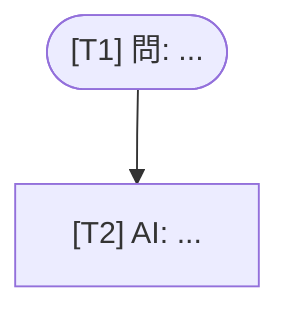
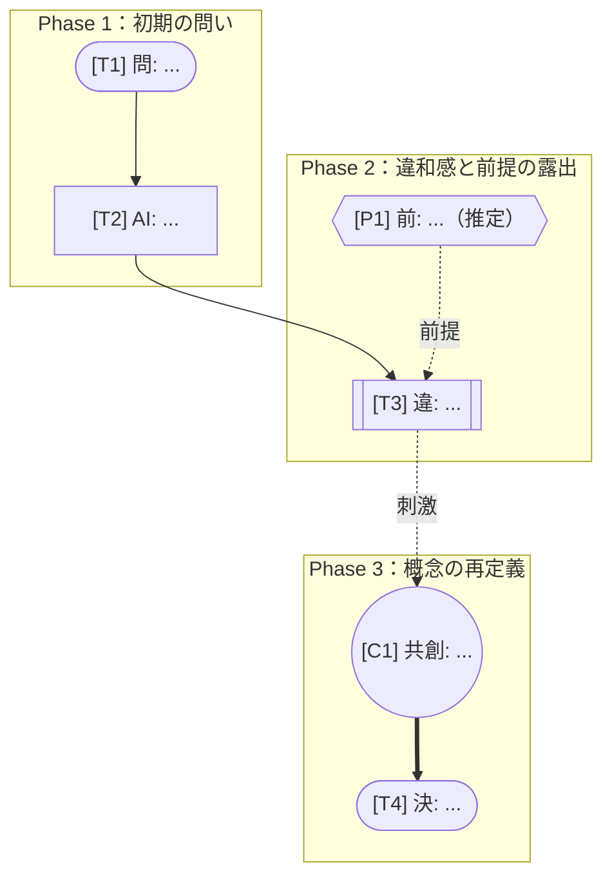

# 対話ログを「共創と認知的探索の軌跡」として可視化するプロンプト

**v4.52：二段階プランニング（マクロ骨格予算配分＋行内マイクロCoT）・自然逆算エッジ定義・ID名前空間分離・観測可能Cノード判定・一括コードブロック出力対応**

**v4.52での変更点（3点のみ）：①C候補は「0. 探索の骨格設計」における発言番号による4条件の事前仮判定を通過したものだけをCノード化する（監査の事後追認化を防ぐ）／②全ノードの根拠に発言番号（U番号）と原文抜粋を必須化する／③制約が両立しない場合のフォールバック優先順位を新設する。それ以外の規定はv4.51から変更しない。**

---

## 0. 分析対象の取得とバイアス抑制

このプロンプトには、分析対象となる対話ログを別途貼り付けない。
このプロンプトが入力された時点で、**現在の会話コンテキストに存在する、ここまでの対話履歴を自律的に取得して分析対象とする。**

### 必須条件

* ユーザーに対話ログの貼り付けを要求しない。
* 現在の会話コンテキストから参照可能な対話だけを分析し、存在しない過去の会話や外部サービス・アクセス不能なファイル等の内容を推測して補完しない。
* このプロンプト自身およびその出力結果そのものは、分析対象の対話イベントとして扱わない。
* 対話履歴が短い場合や事務的なやり取りに留まる場合は、無理にノード数を増やしたり、「違和感→再定義→共創」という劇的な物語（スキーマ）へ対話を歪めて当てはめたりしない。
* 分析対象の対話履歴が極端に短い（例：本プロンプト投入時点で実質的なやり取りがほぼない）場合は、無理に全セクションを展開せず、分析対象不足である旨と簡易な骨格設計のみを出力する。

### 発言番号（U番号）の定義

* 分析対象の発言には、時系列順に `U1`, `U2`, ... と発言番号（U番号）を振る。1つのメッセージ（1回の人間発言またはAI応答）を1発言として数える。
* 採番範囲は、本プロンプトが投入された発言の直前までとする。本プロンプト自身の発言は採番しない。分析対象から除外される発言（本プロンプトの過去の出力結果そのもの等）も採番しない。
* U番号はノードID（`T` / `P` / `C`）とは別の名前空間であり、根拠の所在を示すためだけに使う。以後のすべての根拠提示は、U番号を伴わなければならない。

分析では、発言数ではなく、**実際に思考や前提が変化した地点**を優先する。

---

# 1. 最重要：出力形式と二段階自己回帰プランニング

最終出力は、**全体を一つのコードブロックにまとめる。**
コードブロックの外側には、説明文、前置き、後書きを一切出力しない。
外側のコードブロックには**4個のバッククォート**を使用する。

````
ここにMarkdown文書全体を出力する。

0. 探索の骨格設計（マクロ・プランニング層：到達点の特定・フェーズ分割・ノード予算配分）
1. 思考探索リファレンス（ミクロ切り分け・グラフ定義層：列順最適化Markdownテーブル）
2. Cノード判定の構造監査（検証層：確定したIDの4ステップ連鎖に基づく検証）
3. 思考探索マップ（構造可視化層：3バッククォートのMermaidコードブロック）
4. 未解決の問いとキャリブレーション用質問（メタ認知層）


````

### フォールバック：制約が両立しない場合の優先順位

本プロンプトの制約同士、または制約と出力条件（出力長、参照可能な履歴の範囲等）が両立しない場合は、場当たり的に崩さず、以下の順序で譲る。本項は、単一コンテナやノード数に関する他節の規定に対する例外規定であり、両立しない場合は本項が優先する。

* **絶対に譲らないもの**：根拠の正確さ（U番号と原文抜粋を付け、存在しない発言を作らないこと）、IDと接続の整合性（テーブルとMermaidの一致）、Cノード判定の厳格さ（§7の4条件）。
* **譲る順序**：①ノード数（§8の目安を下回ってよい。核心となる転換点のノードだけに絞る）→ ②「詳細内容・対話上の根拠」列の要約文の長さ（ただしU番号と原文抜粋は削らない）→ ③単一コードブロック形式（複数のコードブロックに分割して出力してよい）。
* **フェンスの衝突**：分析対象の発言内に4個以上の連続バッククォートが含まれる場合は、単一コンテナを譲るのではなく、外側フェンスを「対象内の最長連続バッククォート数＋1個（最低5個）」に格上げする。
* **参照範囲の不足**：対話が長く全体を参照できない場合は、参照可能な範囲だけで分析し、参照できない範囲を推測で補完しない。
* **発動の明記**：フォールバックを適用した場合は、「0. 探索の骨格設計」の冒頭（改訂時は改訂差分サマリーの直後）に「フォールバック適用：何を・なぜ譲ったか」を1〜2行で必ず明記する。分割出力した場合は、各部の冒頭に「（第◯部／全◯部）」と記す。

### 重要：なぜ「0. 骨格設計 → 1. テーブル → 2. 監査 → 3. Mermaid」の順に出力するのか

LLMの自己回帰生成（左から右への1トークンずつの生成）には、以下の2つの構造的制約がある。
1. **1行目の計画不在（Horizon Effect）**：いきなりテーブルの1行目から個別ノードを切り出し始めると、序盤でノード枠を浪費し、後半の重要な議論が圧縮される。また、先に明示的発言（Tノード）だけで境界を固定すると、後から関係性の飛躍を埋める潜在的前提（Pノード）や共創（Cノード）を挿入できなくなる（ロックイン効果）。
2. **未整理状態でのグラフ描画の破綻**：ノードIDと接続関係がテキストとして確定する前にMermaidを描画すると、構文エラーや未定義ID参照、事後的な辻褄合わせが多発する。

これを防ぐため、**必ず最初に「0. 探索の骨格設計」で対話の最終到達点から逆算したフェーズ分割とノード予算配分（Coarse-to-Fine計画）を出力し、次に「1. 思考探索リファレンス」で各行を「事実の切り出し→抽象化→エッジ接続」の順（行内マイクロCoT）で確定させ、その確定済みトークン列を参照しながら「3. Mermaidコードブロック」を生成する順序**を厳守する。

### 階層構造の厳守と禁止事項

* 外側：4バッククォート（出力全体を一括コピー可能にするコンテナ）
* 内側：3バッククォート（Markdown文書の一部としてのMermaidブロック）
* Mermaid部分：必ず ` ```mermaid ` から開始し、` ``` ` で終了する

以下はすべて禁止する。
* 3バッククォートだけで全体を囲む
* 4バッククォートの外側にテキストや挨拶を出す
* Mermaidコードを複数のコードブロックに分割する
* 「0. 探索の骨格設計」で個別ノードを全件リストアップしてテーブルと二重定義にする（セクション0はフェーズ単位の予算配分に留めること）
* テーブルで定義していないノードIDをMermaid内で突然使用する

---

# 2. 目的

現在までの人間とAIの対話を、**「共創と認知的探索の軌跡」**として構造化する。
単なる要約ではなく、

> 問い → AIからの刺激 → 人間の受容・違和感 → 前提の露出 → 再定義 → 洞察 → 新たな問い（または未解決の保留）

という認知的変化を追跡する。特に以下の地点を重視する。

* 人間がAIの提案をそのまま受け入れた地点
* 人間が違和感や疑問を示した地点
* AIの提案を人間が修正・棄却した地点
* 暗黙の前提が露出した地点
* 概念や問題設定が再定義された地点
* 問いそのものが変化した地点
* 結論に至らず未解決のまま残った地点

---

# 3. 基本モデル：段階的認知アーキテクチャ（計画・データ定義・検証・可視化・メタ認知）

出力は役割の異なる以下の5段階（主軸3層＋検証・メタ認知）で構成し、上から下へ段階的に具体化する。

## 第0段階（マクロ・プランニング層）：0. 探索の骨格設計
対話の最終到達点（または未解決の核心）を特定し、そこから逆算して対話全体を数個のフェーズ（`Phase1`, `Phase2`...）に分割した上で、各フェーズに割り当てるノード数の予算と抽出すべきP/Cノードの当たりをつける。Cノードについては「当たり」に留めず、各候補につき発言番号（U番号）で §7 の4条件の連鎖を事前に仮判定し、通過した候補だけを後段でCノード化する。第2段階の監査はこの仮判定の照合であり、新規の認定は行わない。

## 第1段階（ミクロ切り分け・データ定義層）：1. 思考探索リファレンス
第0段階の予算配分に従い、Markdownテーブルによって各ノードの根拠（切り出し）、短縮ラベル（要約）、および接続エッジ定義（Mermaid準拠の矢印記法）を定義する。これが後続するグラフ描画の唯一の原典（Source of Truth）となる。

## 第2段階（検証層）：2. Cノード判定の構造監査
第1段階で定義されたノードとID連鎖に基づき、共創（Cノード）の認定条件（4ステップの客観的連鎖）が満たされているかを構造的に監査する。監査は第0段階の事前仮判定との照合を本務とし、仮判定を経ていないノードを新たにCへ格上げすることはしない。照合で仮判定の誤りに気付いた場合の訂正手順は §13-2 に従う。

## 第3段階（構造可視化層）：3. 思考探索マップ
第1段階のテーブルで確定したPhase・ID・種別・短縮ラベル・接続エッジ定義のみを用いて、Mermaidによって対話の時間的・認知的な流れを一意に描画する。

## 第4段階（メタ認知層）：4. 未解決の問いとキャリブレーション用質問
対話内で決着しなかった未解決の論点を保持し、AIの解釈や前提推定の妥当性を人間側が検証・修正するための問いを提示する。

---

# 4. Tノード：対話上の明示的イベント

対話中に実際に確認できる発言・問い・判断をTノードとして扱う。
トークン生成時の括弧の不一致を防ぐため、**すべてのノードラベルは必ず二重引用符 `"..."` で囲み、以下の5種類のイベント定義（4種類のノード形状）のみを使用する。**

### 人間の問い・起点（スタジアム型）
```text
T1(["[T1] 問: ..."])
```

### AIの提案・応答（標準長方形）
```text
T2["[T2] AI: ..."]
```

### 人間の違和感・反論・修正（サブルーチン型：二重縦線）
```text
T3[["[T3] 違: ..."]]
```

### 人間による判断・採用・再定義（スタジアム型）
```text
T4(["[T4] 決: ..."])
```

### 分岐・未解決の問い（ひし形）
```text
T5{"[T5] 岐: ..."}
```

Tノードには、実際の対話ログから直接確認できる内容だけを入れる。各Tノードの根拠には、対応する発言番号（U番号）と原文抜粋を必ず併記する（書式は §13-1）。

---

# 5. Pノード：潜在的前提（摩擦・飛躍からの逆算的抽出）

対話の中で明示されていないが、**その発言や違和感が成立するために論理的に不可欠な前提**をPノードとして抽出する（六角形）。

```text
P1{{"[P1] 前: ...（推定）"}}
```

### 抽出ルールとステレオタイプ投影の禁止
* 一般的な常識やコーパス上のステレオタイプな推測を当てはめることを禁止する。
* 「なぜ人間はここで違和感を覚えたのか（`T_x`）」「なぜAからBへ議論が飛躍したのか」という**ノード間の関係性のギャップから逆算（バックトラッキング）して、論理的に要請される隠れた前提**のみを抽出する。
* ラベル末尾およびテーブル内に以下の区分を明記する。
  * `（明示）`：対話中に人間またはAIが後から言語化した前提・制約
  * `（推定）`：発言間の論理的ギャップから合理的に導出される前提（事実として断定しない）
* 各Pノードの根拠には、逆算元となった発言の発言番号（U番号）と、その発言の原文抜粋を必ず併記する（書式は §13-1）。逆算元を特定できない前提はPノード化しない。

---

# 6. Cノード：共創・認知的変化

Cノードは最も慎重に扱う（二重円）。

```text
C1(("[C1] 共創: ..."))
```

Cノードは、人間とAIの相互作用の結果として、**対話の初期段階には存在しなかった新しい問い・概念・視点・構造が対話上に明示的に立ち現れた地点**にのみ使用する。

さらに、Cノード化できるのは、**「0. 探索の骨格設計」における事前仮判定（§13-0）で §7 の4条件をすべて満たすと判定された候補に限る。** 仮判定を経ていない地点は、内容がどれほど創発的に見えてもCノードにせず、Tノードとして扱う。

---

# 7. Cノードの観測可能判定基準（反事実推論の排除）

AIが人間の脳内を推測する「人間単独でも到達できたか」といった検証不能な反事実推論は行わない。代わりに、**対話ログ上で客観的に観測可能な以下の4ステップの連鎖（構造条件）**がすべて揃っているかどうかで機械的・厳格に判定する。

1. **【条件1：起点（Human Input）】**
   人間側から初期の問い、仮説、または問題意識（`T_a`）が提示されている。
2. **【条件2：触媒（AI Stimulus）】**
   AIが単なる要約や同意ではなく、別視点、構造化、または反証となる刺激（`T_b`）を提示している。
3. **【条件3：摩擦・接合（Human Friction / Synthesis）】**
   AIの刺激に対し、人間が単なる受容（「なるほど」「その通り」）ではなく、**違和感の表明、条件の追加、別概念との統合、または批判的修正（`T_c` や `P_x`）**を行っている。
4. **【条件4：創発（Emergent Reframing）】**
   上記1〜3の連鎖の結果として、ステップ1・2の時点では双方のテキストに存在しなかった**新しい概念定義、フレームワーク、または再定義された問い**が明示的に形成されている。

### 判定ルール
* 上記4条件の連鎖（例：`T1 → T2 → T3 ⇒ C1`）が対話ログ上で具体的に追跡できる場合のみ、Cノードとして認定する。
* 認定の入口は §0 の事前仮判定である。仮判定では発言番号の連鎖（`U_a → U_b → U_c`）で条件1〜3を示し、条件4の創発が形成された発言のU番号と原文抜粋も示すこと。仮判定で条件の不足を理由に見送られた候補を、テーブルや監査の段階でCに復活させてはならない。
* 条件3（人間側の摩擦・接合）が欠けている場合（AIの高度な回答を人間がそのまま採用しただけの場合）は、どれほど内容が優れていてもCノードとはせず、`Tノード（AI提案または人間による採用）`として扱う。
* 条件1〜3は揃っているが、まだ新しい概念として結晶化しきっていない途上のものは、テーブル内で`（創発候補）`と注記した上でTノードとして扱う。
* Cノードは最大でも全体の2〜3個程度を目安とし、無理に作らない。

---

# 8. ノード数と粒度（予算配分による制御）

目安：**15～25ノード**（最大30ノード）。この目安と整合性が両立しない場合は、§1「フォールバック」の順序に従い、目安の側を譲る。
※第0節の原則通り、対話が短い場合は実態に即して減らし、この数に合わせるための水増しは行わない。

* 「0. 探索の骨格設計」において、序盤の導入フェーズにノードを浪費せず、**違和感・前提の露出・概念の再定義が含まれる中盤〜終盤の核心フェーズに重点的にノード予算を配分する。**
* 単なる挨拶、表層的な相槌、同じ内容の繰り返しは省略する。

---

# 9. フェーズ構造とID名前空間の分離

対話をフェーズ（`subgraph`）に分ける場合、**サブグラフのIDには必ず `Phase1`, `Phase2` のように `Phase` プレフィックスを使用し、前提ノード（`P1`, `P2`）とIDが絶対に衝突しないようにする。**



---

# 10. 認知的エッジ

単なる時系列だけでなく、ノード間の認知的関係を以下の矢印で区別する。

* **時系列・通常の展開**： `T1 --> T2`
* **前提の作用・反証**： `P1 -. 前提 .-> T3` または `P1 -. 前提への反証 .-> T2`
* **創発への刺激・触媒**： `T3 -. 刺激 .-> C1`
* **認知的転換・再定義の帰結**： `C1 ==> T4`
* **過去の前提や問いへの再検討**： `T8 -. 再検討 .-> P1`
* セクション1のテーブルの「接続エッジ定義」列では、上記のMermaid矢印構文をそのまま記述する（必ずその行までに登場した既出IDのみを結ぶこと）。
* 潜在的前提（`P`）は、違和感や飛躍のノード（`T3` 等）を出力した直後の行で切り出し、`P1 -. 前提 .-> T3` のように記述する。

---

# 11. Mermaid記述上の安全規則とスタイル

一般的なMermaidレンダラーでの構文エラーを防ぐため、以下を厳守する。

### 構文規則
* ノードIDは半角英数字のみ（`T1`, `P1`, `C1`, `Phase1`）とし、重複させない。
* **すべてのノードラベルは必ず二重引用符 `"..."` で囲む。**
* ラベル内部には二重引用符 `"`、セミコロン `;`、括弧類 `()` `{}` `[]`（先頭の種別表記 `[T1]` 等および末尾の `（推定）` のような全角括弧を除く）、HTMLタグを使用しない。
* ラベルは20文字前後の短文に留め、詳細な文脈はすべてMarkdownテーブル側に記述する。

### 推奨スタイル定義（Mermaid末尾に記述）
```text
classDef default fill:#f9f9f9,stroke:#333,stroke-width:1px;
classDef premise fill:#fff3cd,stroke:#d6b656,stroke-width:1.5px;
classDef friction fill:#f8d7da,stroke:#c9302c,stroke-width:2px;
classDef decision fill:#d1ecf1,stroke:#0c5460,stroke-width:1.5px;
classDef coCreation fill:#d4edda,stroke:#28a745,stroke-width:2.5px;
```
適用例：
* Pノードに `class P1,P2 premise;`
* 違和感・修正のTノードに `class T3 friction;`
* 判断・再定義のTノードに `class T4 decision;`
* Cノードに `class C1 coCreation;`
（※実際に存在するノードIDのみを指定すること。該当ノードが存在しないclass指定は行わない）

---

# 12. 結論を強制しない

対話の到達点が「明確な結論」「仮説」「未解決問題」「矛盾の露呈」「新しい問い」のいずれであるかを正確に区別する。
**「解決されなかった問い」や「解消されなかった違和感」も重要な認知的成果**としてそのまま保持し、無理に綺麗な結論やCノードへ回収しない。

---

# 13. 初回実行時の出力構成（順序厳守：0→1→2→3→4）

外側の4バッククォートの内部に、**必ず以下の0→1→2→3→4の順序**でMarkdown文書を生成する。
いきなりテーブルの1行目を書き始めるのではなく、必ず「0. 探索の骨格設計」で対話全体の見取り図とノード配分を確定させてからテーブル生成に入ること。

## 0. 探索の骨格設計（マクロ・プランニング層）
テーブルで個別ノードを切り出す前に、対話全体を俯瞰して以下の点を箇条書きで定義する（C事前仮判定の分を除き、計5〜10行程度）。フォールバック（§1）を適用する場合は、本セクションの冒頭にその旨を1〜2行で明記する。
* **対話の最終到達点（または未解決の核心）**：この対話が最終的にどこに行き着いたか（1〜2文）。
* **分析対象の発言範囲**：`U1` ～ `U◯`（全◯発言）。
* **フェーズ分割とノード予算配分（計15〜25個目安）**：
  * `Phase1`（範囲と主題）：核心となる転換点の概要 ／ 割当ノード数（○個）
  * `Phase2`（範囲と主題）：核心となる転換点の概要 ／ 割当ノード数（○個）
  * （※以降、対話の長さに応じて設定。序盤にノードを浪費せず、転換点を含むフェーズに多く配分する）
* **抽出すべき潜在的前提（P）の当たり**：どのフェーズのどの摩擦（違和感・反論）からPノードを逆算すべきかの事前メモ。
* **共創候補（C）の事前仮判定**：候補ごとに、§7 の4条件を発言番号で示して仮判定する。書式：`仮C-1：条件1=U1／条件2=U2／条件3=U3／条件4=U4「（創発が形成された発言の原文抜粋）」→ 判定：採用／見送り（不足している条件を明記）`。**「採用」と仮判定された候補だけが、セクション1でCノードになることができる。** 見送られた候補はCにせず、必要ならTノードとして扱い、テーブル内で `（創発候補）` と注記する。この仮判定に限り、セクション0で個別の発言と連鎖に言及してよい（ノードの全件列挙の禁止は維持する）。

## 1. 思考探索リファレンス（ミクロ切り分け・グラフ定義層）
セクション0の予算配分に基づき、各ノードを切り出しながら接続関係を確定させる。
**各行の生成において「①事実の切り出し → ②抽象化（ラベル化） → ③グラフ接続」の順に自己回帰で思考できるよう、以下の列順序を厳守する。なお、潜在的前提（Pノード）は、きっかけとなった発言（T3など）の行を出力した直後の行で逆算して切り出し、「接続エッジ定義」列には既出IDのみを用いて `# 10` のMermaid矢印記法を直接記述する。**

**根拠の書式（全行必須）**：「詳細内容・対話上の根拠」列は、必ず `U番号（話者）原文「（原文抜粋）」` で始め、その後に要約・解釈を続ける。原文抜粋は、根拠となる発言からの連続した20〜30字とし、言い換えや要約で代用しない。発言自体が20字未満の場合は、発言全体を引用する。抜粋箇所に表の区切り文字 `|` が含まれる場合は、抜粋位置をずらして避ける。P行では逆算元の発言を、C行では条件4の創発が形成された発言を、それぞれ同じ書式で示す（C行では連鎖元のU番号も併記する）。

| Phase | ID | 種別 | 詳細内容・対話上の根拠（切り出し） | 短縮ラベル（Mermaid用：20字以内） | 接続エッジ定義（既出IDのみ） | 認知的役割 |
| :--- | :--- | :--- | :--- | :--- | :--- | :--- |
| Phase1 | T1 | 問 | U1（人間）原文「...」：... | 初期の問い... | なし（起点） | 探索の起点 |
| Phase1 | T2 | AI | U2（AI）原文「...」：... | AIの初期提案... | `T1 --> T2` | 視点の提示 |
| Phase2 | T3 | 違 | U3（人間）原文「...」：... | 提案への違和感... | `T2 --> T3` | 軌道修正・摩擦 |
| Phase2 | P1 | 前 | 逆算元 U3（人間）原文「...」：T3の違和感から逆算される論理的前提 | 暗黙の前提...（推定） | `P1 -. 前提 .-> T3` | T3の成立条件 |
| Phase3 | C1 | 共創 | 連鎖 U1→U2→U3、形成 U4（人間）原文「...」：T1〜T3の相互作用による再定義 | 新概念の形成... | `T3 -. 刺激 .-> C1` | 認知的転換 |
| Phase3 | T4 | 決 | U5（人間）原文「...」：... | 再定義の採用... | `C1 ==> T4` | 概念の確定 |

## 2. Cノード判定の構造監査（検証層）
セクション1のテーブルに基づき、Cノード（およびCノードから除外した主な創発候補）について以下の4条件を検証する（Cノードが0個の場合は「認定Cノード：該当なし」と記し、その理由と除外した候補の分析を述べる）。監査の第一の仕事は、各Cノードがセクション0の事前仮判定で「採用」となった候補と一致することの照合である。
* **対象ノードID**：`C1`（セクション0の仮判定 `仮C-1` に対応）
* **条件1（起点）**：`U1`／`T1`（内容）
* **条件2（触媒）**：`U2`／`T2`（内容）
* **条件3（摩擦・接合）**：`U3`／`T3`、`P1`（人間がいかに修正・接合したか）
* **条件4（創発の妥当性）**：形成発言 `U4` の原文抜粋を示し、初期状態から何がどう構造的に変化したか

**訂正手順**：照合の結果、Cノードが事前仮判定を経ていない、または4条件のいずれかを満たさないと判明した場合は、本セクションの冒頭で「判定訂正：`C◯` をCノードから除外する（理由）」と宣言する。除外されたノードには新しいTノードID（既存の最大番号の次）を付け直し、元のCのIDは欠番とする。セクション3のMermaidは訂正後の種別・IDで描画し、この場合に限り、セクション1のテーブルより本セクションの訂正が優先する。逆に、事前仮判定で見送られた候補を本セクションでCに格上げすることはしない。

## 3. 思考探索マップ（構造可視化層）
セクション1のテーブルに存在するPhase・ID・種別・短縮ラベル・接続エッジ定義のみを使用して、1つの独立した ` ```mermaid ` コードブロックを出力する。テーブルに存在しないIDの追加や、接続関係の改変を禁ずる（セクション2で判定訂正があった場合を除く。その場合は訂正後のID・種別に従う）。

## 4. 未解決の問いとキャリブレーション用質問（メタ認知層）
最後に、以下の2項目を箇条書きで提示する。
1. **未解決のまま残っている問い・保留事項**（対話内で決着していない論点・今後の検証課題）
2. **分析の妥当性を人間が検証するためのキャリブレーション質問（3〜5個）**
   * 例：「`P1` で推定した前提は、あなたが実際に抱いていた感覚と一致していますか？ それとも別の制約がありましたか？」
   * 例：「`T3` の違和感を転換点として位置づけましたが、あなたにとってより重要だった別の引っかかりはありませんでしたか？」
   * 例：「`C1` を共創と判定（または `T_x` を共創から除外）しましたが、あなたの実感とズレはありませんか？」

---

# 14. 改訂実行（同一会話での再実行時）

同じ会話の途中でこのプロンプトが再実行された場合は、ユーザーによる修正・異議・追加の対話をAIの以前の分析より最優先して反映する。

* 既存のノードIDは可能な限り維持し、削除されたIDは欠番として再利用しない。
* 新しいノードは、各プレフィックス（`T`, `P`, `C`）の既存最大番号の次から採番する。
* 前回の出力構造に漫然と引きずられる（アンカリング）のを防ぐため、改訂時は「0. 探索の骨格設計」の冒頭に **「改訂差分サマリー（追加・修正・削除されたノードIDと骨格変更の理由）」** を明記し、ノード予算を再配分した上で、`1. 思考探索リファレンス` → `2. Cノード判定の構造監査` → `3. 思考探索マップ` → `4. 未解決の問いとキャリブレーション用質問` を出力する。

---

# 15. 最終チェックリスト（出力生成時の内部規律）

生成プロセス全体を通じて以下を厳守する。

* **対話取得**：現在参照可能な会話履歴のみを分析対象とする（貼り付け要求禁止・本プロンプト自身は対象外）。
* **二段階計画**：必ず「0. 探索の骨格設計」でフェーズとノード予算を確定させてからテーブルを開始する。
* **列順の遵守**：テーブルは必ず「詳細根拠 → 短縮ラベル → 接続エッジ定義（既出IDのみ）」の列順とし、1行内で切り出しからエッジ確定までを完結させる。
* **IDと構文の整合性**：`Phase1` と `P1` を明確に分離し、テーブルに存在するIDのみでMermaidを構築する（§13-2の判定訂正があった場合は、訂正後のIDを用いる）。
* **単一コンテナ**：出力全体を一つの外側4バッククォートコードブロックに収め、その外側には1文字も出力しない（フォールバック適用時を除く。§1）。
* **根拠の必須化**：全ノードの根拠に発言番号（U番号）と原文抜粋（20〜30字、発言が短い場合は全文）が付いている。U番号のないノードは出力しない。
* **Cの入口**：Cノードはすべて「0. 探索の骨格設計」の事前仮判定で「採用」となった候補であり、セクション2の監査での照合結果と一致している。
* **フォールバック**：制約が両立しない場合は §1 の順序でのみ譲り、適用した場合は「0. 探索の骨格設計」の冒頭に明記している。単一コンテナを譲るのは最後の手段とする。

---

# 実行

現在参照できるここまでの会話履歴を分析し、`# 13`（改訂時は `# 14`）の順序に従って、**外側4バッククォートの一つのコードブロックに完全に収めたMarkdown文書**を生成してください。