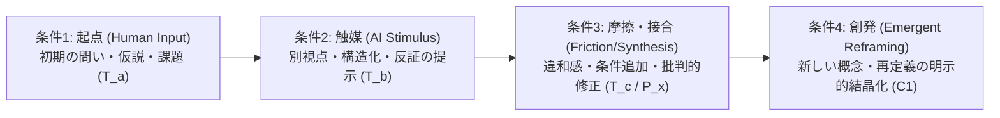

# Mermaid Live Previewer 📐

ブラウザだけで動作する、単一ファイル完結型の **Mermaid リアルタイム構文プレビュー & エクスポートツール (SPA)** です。  
サーバー不要で、HTML ファイルをブラウザで開くだけですぐに利用できます。

---

## ✨ 主な機能

### 1. リアルタイム・プレビュー
- **入力連動レンダリング**: タイピングに合わせて 250ms デバウンスで自動レンダリング。
- **堅牢な世代管理**: 連続入力時も最新の構文のみを描画し、描画競合（レースコンディション）を防止。
- **構文エラー即時通知**: 構文エラー発生時はステータスバッジと詳細メッセージボックスで瞬時にフィードバック。

### 2. 直感的なキャンバス操作（パン & ズーム）
- **マウスポインタ中心ズーム**: ホイール操作でカーソル位置を中心とした直感的な拡大・縮小。
- **ドラッグ操作によるパン**: プレビュー領域を自由に移動可能。
- **マルチタッチ対応**: スマートフォンやタブレットでの 2 本指ピンチイン/アウトおよびパン操作に対応。
- **ビューコントロール**:
  - `+` / `-` ボタンによる拡大縮小
  - `100%` 表示リセット
  - `フィット` ボタン（図全体を現在の画面枠内に自動スケール調整）

### 3. 多彩なエクスポート機能
- **SVG コピー**: ワンクリックで SVG コードをクリップボードにコピー（モダン Clipboard API 対応）。
- **SVG 保存**: ベクター画像ファイル（`.svg`）としてダウンロード。
- **高解像度 PNG 保存**: `<canvas>` 経由で **2倍スケール（高解像度）** の PNG 画像（`.png`）を生成・保存。Slack、Notion、Google Docs、PowerPoint 等への貼り付けに最適です。

### 4. 豊富なサンプルテンプレート
ドロップダウンから選択するだけで、主要なダイアグラム構文を即座に呼び出せます。
- フローチャート (`flowchart`)
- シーケンス図 (`sequenceDiagram`)
- クラス図 (`classDiagram`)
- 状態遷移図 (`stateDiagram-v2`)
- ER図 (`erDiagram`)
- ガントチャート (`gantt`)
- マインドマップ (`mindmap`)

### 5. テーマ切り替え & ダークモード連動
- Mermaid テーマの切り替えに対応（`default` / `neutral` / `dark` / `forest`）。
- **ダークテーマ連動**: `dark` テーマ選択時はプレビューキャンバスの背景も自動でダークグレー（`#0f172a`）に切り替わり、淡色のテキストや境界線も鮮明に表示されます。

### 6. エディタ機能 & 自動保存
- **インデント支援**:
  - `Tab`: 4 スペース挿入（単一行・複数行選択の両方に対応）
  - `Shift + Tab`: インデント削除（先頭スペース削除）
- **文字数カウンター**: リアルタイムで入力文字数をカウント。
- **LocalStorage 永続化**: 入力コード、選択テーマ、分割レイアウト（上下 / 左右）を自動保存。ブラウザをリロードしても直前の作業状態をそのまま復元。

### 7. レスポンシブ & 柔軟なレイアウト
- デスクトップ環境では **上下配置** と **左右分割** をボタン 1 つでシームレスに切り替え可能。
- モバイル・タブレット画面にも最適化。

---

## 🚀 使い方

### 最も簡単な方法（ダブルクリック起動）
1. 本リポジトリ内の `Mermaid & Markdown previewer_v0.9.html` を任意のブラウザ（Chrome, Edge, Safari, Firefox）で直接開きます。

### ローカルサーバー経由で開く場合
ローカルサーバー経由で動作させる場合は、以下のいずれかのコマンドを実行してください。

```bash
# Python 3 を使用する場合
python3 -m http.server 8000

# Node.js (npx serve) を使用する場合
npx serve .
```

ブラウザで `http://localhost:8000/Mermaid%20&%20Markdown%20previewer_v0.9.html`（またはローカルファイルパス）にアクセスします。

---

## ⌨️ キーボードショートカット & 操作一覧

| 操作 | 動作 |
| :--- | :--- |
| **マウスホイール** | マウスポインタを中心とした拡大 / 縮小 |
| **左ボタンドラッグ** | プレビュー図のパン（移動） |
| **2本指ピンチ (タッチ)** | タッチ端末でのピンチズーム |
| **Tab** | 4スペースのインデント挿入 |
| **Shift + Tab** | 先頭4スペースのアンインデント（削除） |
| **ペースト ボタン** | クリップボードのテキストをエディタに貼り付け |
| **クリア ボタン** | 入力内容をリセット |
| **フィット ボタン** | 現在のプレビュー枠内に図全体を収める |

---

## 🛠 技術スタック & アーキテクチャ

- **フロントエンド構造**: HTML5, Vanilla JavaScript (ES2020+)
- **スタイリング**: Vanilla CSS + Tailwind CSS (CDN)
- **ダイアグラム描画エンジン**: [Mermaid.js](https://mermaid.js.org/) (v11.x)
- **座標変換モデル**: 
  - 移動（パン）を担当する `transformWrapper`（`calc(-50% + translateX, calc(-50% + translateY))`）と、拡縮を担当する `scaleWrapper`（`scale(...)`）を分離した 2 階層 Transform 設計。
- **セキュリティ**:
  - `mermaid.initialize({ securityLevel: 'strict' })` による厳格な XSS 保護。
---

## 📂 ディレクトリ構成

```text
.
├── Mermaid & Markdown previewer_v0.9.html                                     # アプリケーション本体（単一ファイル SPA）
├── Prompt_Trajectory_of_daialogue_search(2-layer_structhre_index_annnotation  # 対話探索軌跡可視化プロンプト（付録参照）
└── README.md                                                                  # 本ドキュメント
```

---

## 📎 付録: `Prompt_Trajectory_of_daialogue_search` の機能と解説

本リポジトリに含まれるプロンプトファイル **`Prompt_Trajectory_of_daialogue_search(2-layer_structhre_index_annnotation)`** は、人間とAIの対話ログを単なる時系列要約ではなく、**「共創と認知的探索の軌跡」** として構造化・可視化するための高機能システムプロンプト（v4.4）です。

生成された Mermaid コードを本ツール（Mermaid Live Previewer）に入力することで、対話における思考の深まり、暗黙の前提、共創的転換点をインタラクティブに検証・俯瞰できます。

---

### 1. 目的と基本思想

対話を単なる「質問と回答の繰り返し」としてではなく、以下の認知的サイクルとして捉え直します：

> **問い → AIからの刺激 → 人間の受容・違和感 → 前提の露出 → 再定義 → 洞察 → 新たな問い（または未解決の保留）**

特に以下の転換地点を重視し、構造化します：
- 人間が違和感や疑問を示した地点（批判的修正・摩擦）
- 議論の飛躍を支えていた「暗黙の前提」が露出した地点
- 概念や問題設定そのものが再定義（リフレーミング）された地点
- 安易に結論づけず、あえて「未解決のまま保留」された核心課題

---

### 2. 三層認知アーキテクチャ & 二段階自己回帰プランニング

LLMの自己回帰生成における **「Horizon Effect（1行目の計画不在によるノード予算の枯渇）」** や **「未整理状態でのグラフ描画破綻」** を防ぐため、以下の順序厳守による段階的生成（Coarse-to-Fine）を採用しています。

```
第0層：探索の骨格設計（マクロ・プランニング層：到達点の特定・フェーズ分割・ノード予算配分）
  ↓
第1層：思考探索リファレンス（ミクロ切り分け・データ定義層：行内マイクロCoTによるMarkdownテーブル）
  ↓
検証層：Cノード判定の構造監査（客観的4ステップ連鎖による共創検証）
  ↓
第2層：思考探索マップ（構造可視化層：Mermaidコードブロック）
  ↓
メタ認知層：未解決の問いと人間によるキャリブレーション用質問
```

1. **第0層：探索の骨格設計（マクロ・プランニング）**  
   対話の最終到達点（または未解決の核心）をまず特定し、対話全体を複数のフェーズ（`Phase1`, `Phase2`...）に分割。転換点を含む重要フェーズにノード予算（目安15〜25ノード）を重点配分します。
2. **第1層：思考探索リファレンス（データ定義層 / Source of Truth）**  
   テーブルの各行を `事実の切り出し（対話根拠） → 抽象化（短縮ラベル） → グラフ接続（先行ID）` の順（行内マイクロCoT）で出力し、後続のグラフ描画の原典（Source of Truth）を確定させます。
3. **検証層：Cノード判定の構造監査**  
   主観的な反事実推論を排除し、観測可能な対話ログの連鎖に基づいて「共創」を客観的に監査します。
4. **第2層：思考探索マップ（構造可視化層）**  
   テーブルで確定済みのノードID・短縮ラベル・接続関係のみを用いて、単一の Mermaid コードブロックを描画します。
5. **メタ認知層：未解決の問い & キャリブレーション質問**  
   未解決の論点を明示するとともに、AIの解釈が人間の主観的実感と整合しているかを人間側が検証するための問い（3〜5問）を提示します。

---

### 3. ノード種別と認知的セマンティクス

ノードの役割に応じて形状とIDプレフィックスが厳密に定義されています。

| 種別 | プレフィックス / 形状 | 意味・役割 | Mermaid表記例 |
| :--- | :--- | :--- | :--- |
| **問 (Question)** | `T` / スタジアム型 `([ ])` | 人間の問い・問題提起・探索の起点 | `T1(["[T1] 問: コンセプト立案"])` |
| **AI (Stimulus)** | `T` / 長方形 `[ ]` | AIの提案・回答・視点提示 | `T2["[T2] AI: 3つの軸を提示"]` |
| **違 (Friction)** | `T` / サブルーチン型 `[[ ]]` | 人間の違和感・反論・条件追加・軌道修正 | `T3[["[T3] 違: 運用負荷が高すぎる"]]` |
| **決 (Decision)** | `T` / スタジアム型 `([ ])` | 人間の判断・方針決定・再定義 | `T4(["[T4] 決: 軽量単一ファイル構成を採用"])` |
| **岐 (Branch)** | `T` / ひし形 `{ }` | 分岐・未解決の問い・検討課題 | `T5{"[T5] 岐: IndexedDB vs LocalStorage"}` |
| **前提 (Premise)** | `P` / 六角形 `{{ }}` | 議論の飛躍や違和感から逆算された「暗黙の前提」（明示／推定） | `P1{{"[P1] 前: 外部通信不可の環境を前提（推定）"}}` |
| **共創 (Co-Creation)** | `C` / 二重円 `(( ))` | 人間とAIの相互作用により新たに立ち現れた新概念・フレームワーク | `C1(("[C1] 共創: 2階層Transform制御"))` |

---

### 4. 観測可能な「Cノード（共創）」判定監査基準

「AIが人間の脳内を推測する検証不能な反事実推論（人間単独でも到達できたか等）」を排除し、対話ログ上で客観的に観測可能な **4ステップの連鎖** をすべて満たした場合にのみ Cノード として認定します。



> [!NOTE]
> 人間がAIの高度な回答をそのまま受容・採用しただけの場合は、条件3（摩擦・接合）を欠くためCノードとは認定せず、通常の `Tノード（AI提案または決定）` として扱います（安易な共創認定の抑制）。

---

### 5. 認知的エッジ（接続線）の表現

時系列の流れだけでなく、認知的相互作用を矢印の線種で表現します：

- **時系列・通常の展開**: `T1 --> T2`
- **前提の作用・制約**: `P1 -. 前提 .-> T3` または `P1 -. 前提への反証 .-> T2`
- **創発への刺激・触媒**: `T3 -. 刺激 .-> C1`
- **認知的転換・再定義の帰結**: `C1 ==> T4`
- **過去の前提や問いへの再検討**: `T8 -. 再検討 .-> P1`

---

### 6. 安全規則と名前空間設計

一般的なMermaidレンダラーでのパースエラー・描画破綻を防止するための規則が組み込まれています：
- **ID名前空間の完全分離**: サブグラフのIDには `Phase1`, `Phase2` を用い、前提ノード（`P1`, `P2`）との衝突を防止。
- **引用符の厳格化**: ラベルは必ず二重引用符 `"[Tx] ..."` で括り、構文エラーとなる記号（HTMLタグ、生の括弧類）をエスケープ・排除。
- **スタイルクラス定義**: 認知的役割（前提、違和感、決定、共創）に応じた色分けクラス（`premise`, `friction`, `decision`, `coCreation`）を自動付与。

---

### 7. 本ツール（Mermaid Live Previewer）での活用手順

1. **プロンプトの実行**: ChatGPTやClaudeなどのAI対話環境に `Prompt_Trajectory_of_daialogue_search(2-layer_structhre_index_annnotation` の内容を入力し、対話履歴を分析させます。
2. **Mermaidコードのコピー**: 出力された「3. 思考探索マップ」内の ` ```mermaid ... ``` ` ブロックをコピーします。
3. **プレビューと調整**: 本ツールに貼り付け、リアルタイムプレビューで思考の構造を確認します。
4. **共有・ドキュメント化**: 必要に応じて拡大・縮小やパン操作でレイアウトを整え、**SVG** または **高解像度 PNG（2x）** としてエクスポートして議事録や設計書、振り返り資料に活用します。

---

## 📄 ライセンス

本プロジェクトは個人利用・商用利用を問わず自由にご利用・改変いただけます。
