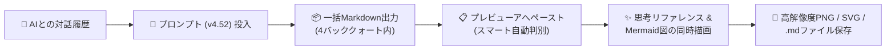

# Mermaid & Markdown Previewer

https://iz-yan592.github.io/Mermaid_Preview/

> **リアルタイム構文プレビューア & AI対話ログ認知構造化ソリューション**

ブラウザ単体で軽快に動作する **Mermaid & Markdown プレビューア** と、AIとの対話履歴を「共創と認知的探索の軌跡」として構造化・可視化する **対話ログ解析プロンプト（v4.52）** を統合したリポジトリです。

入力した文書を外部サーバーへ送信しない完全クライアントサイド動作のため、機密性の高い設計文書やシステムフロー、AIとの思考プロセスログを安全に編集・閲覧・高解像度エクスポートできます。

---

## 🚀 ワークフロー：AI対話から思考マップへの可視化手順

本リポジトリのプロンプトとプレビューアを組み合わせることで、AI（Gemini, Claude, ChatGPT等）との長文対話から思考の転換点や共創プロセスをワンストップで可視化できます。



1. **対話ログの解析**：AIとの対話セッションの末尾に、付属のプロンプト（`Prompt_Trajectory_of_Dialogue_v4.52.md`）をそのまま送信します。
2. **Markdown文書の生成**：AIが5段階の自己回帰プランニングに基づき、発言番号（U番号）付きの思考リファレンステーブルとMermaid構文を含んだMarkdown文書を一括出力します。
3. **ワンタッチプレビュー**：出力されたコードをコピーし、プレビューアに貼り付けるだけで、スマート自動判別により文書と図が美しく即座に描画されます。

---

## 🛠 コンポーネント 1：Mermaid & Markdown Previewer

GitHub Pages による Web 配信、およびローカル環境での直接起動（ZIPダウンロード等）の双方に完全対応した高機能プレビュー環境です。

### ✨ 主な機能

- 🚀 **Web公開 & 完全ローカル両対応（ゼロ構成）**
  - Web上ではもちろん、`dist/index.html` をブラウザで開くだけで即座に動作します。
- 🔄 **デュアルプレビューモード**
  - **📐 Mermaid単体モード**: 自由なパン（ドラッグ移動）、滑らかなズーム（20%〜400%）、画面フィット（縦長図は可読性を保つ**幅フィット＋縦パン**へ自動調整）、100%等倍リセット、ガントチャート等の図種を含めたSVG寸法正規化、エラー通知ボックス。
  - **📝 Markdown文書モード**: GFM（GitHub Flavored Markdown）完全対応。文書内に点在する複数の ````mermaid` ブロックを自動抽出し、インラインカードとして一括レンダリング（描画済みSVGのキャッシュによる高速再描画に対応）。
- 📋 **スマート自動判別ペースト**
  - クリップボードの内容を検知し、Mermaidダイアグラム構文かMarkdown文書かを自動判定して最適なプレビューモードへ自動切替。```mermaid フェンスを含む文書はMarkdown文書として判定され、図はインラインで描画されます。
- 🧩 **サンプル挿入（テンプレート）**
  - Mermaid図7種・Markdown文書2種のテンプレートをプルダウンからワンアクションで挿入できます（現在の内容は全置換されます）。
- 🎨 **4種類のカラーテーマ連動 & コントラスト自動補正**
  - `Default`、`Neutral`、`Dark`（ダークテーマ）、`Forest` をサポート。ダークテーマ選択時はMarkdown文書、テーブル、Mermaidキャンバス背景も自動でダークモードへ最適化されます。
  - ダークテーマ時に `classDef` で淡色背景のみを指定したノードでも文字が埋もれないよう、コントラスト比（3.0未満）を自動検知して文字色を補正します。
- 🖥 **フレキシブルレイアウト**
  - ディスプレイや作業内容に合わせて「上下配置」と「左右分割」をワンクリックで切り替え可能。
- 💾 **状態の自動保存（LocalStorage）**
  - 入力テキスト（各モード別）、選択テーマ、レイアウト設定をLocalStorageへ自動保存。
- 🔒 **厳格なセキュリティ設計 & 耐障害性**
  - Tailwind CSS を事前ビルドした最適化CSS（`assets/tailwind.min.css`）として同梱し、サプライチェーン攻撃リスクを排除。
  - `Mermaid.js`、`Marked.js`、`DOMPurify` は SRI（`integrity="sha384-..."`）を設定したCDN配信を利用（ネットワーク障害等による読込失敗時もアプリ全体を止めずエラー通知）。
  - `isSafeHref` によるリンクプロトコル検証（`http:` / `https:` / `mailto:` / `#` のみ許可）、生HTMLタグのエスケープ、`DOMPurify` によるサニタイズ（`script` / `style`・イベント属性・`foreignObject` 等を禁止）、Mermaid の `securityLevel: 'strict'` を採用。

### 💾 エクスポート機能

| 出力形式                 | 対象モード         | 説明                                                                                                                  |
| :----------------------- | :----------------- | :-------------------------------------------------------------------------------------------------------------------- |
| **高解像度 PNG**         | Mermaidモード      | Retina対応（2xスケール）の鮮明なPNG画像としてダウンロード（見切れ防止の四方16px余白・フォント統一・テーマ背景色適用） |
| **SVG 画像保存**         | Mermaidモード      | 拡大縮小しても劣化しないベクター画像（.svg）として保存（見切れ防止の余白・フォント定義を最適化）                      |
| **SVG コードコピー**     | Mermaid / Markdown | ダイアグラムのクリーンなSVGコードをクリップボードにワンクリックコピー（Markdown内のインライン図も個別コピー可能）     |
| **プレビューHTMLコピー** | Markdownモード     | スタイリングおよびSVG描画済みのHTML全体をクリップボードにコピー（UIボタンや内部属性は自動クリーンアップ）             |
| **.md ファイル保存**     | Markdownモード     | 編集中のMarkdownテキストを `.md` ファイルとして直接保存                                                               |

### ⌨️ キーボードショートカット & 操作方法

| キー / 操作                                 | 動作モード     | 説明                                                                                 |
| :------------------------------------------ | :------------- | :----------------------------------------------------------------------------------- |
| `Ctrl + S` / `Cmd + S`                      | Mermaidモード  | 表示中のダイアグラムを高解像度 **PNG画像** として保存                                |
| `Ctrl + S` / `Cmd + S`                      | Markdownモード | エディタの内容を **.mdファイル** として保存                                          |
| `Tab`                                       | 共通           | 4スペースのインデント挿入（複数行選択にも対応）                                      |
| `Shift + Tab`                               | 共通           | インデント（最大4スペース）の解除                                                    |
| `2本指スクロール / ホイール`                | Mermaidモード  | ダイアグラムの縦方向パン（移動）                                                     |
| `ピンチ（トラックパッド）/ Ctrl + ホイール` | Mermaidモード  | ダイアグラムの拡大・縮小（マウスカーソル位置を中心）                                 |
| `ドラッグ移動`                              | Mermaidモード  | ダイアグラムキャンバスのパン（移動）                                                 |
| `ピンチイン / ピンチアウト`                 | Mermaidモード  | タッチ端末での拡大・縮小                                                             |
| `ステータスバッジをクリック`                | Markdownモード | 図にエラーがある場合、該当するダイアグラムカードへスムーズスクロール＆赤枠ハイライト |

### 📊 対応ダイアグラム（Mermaid）

- フローチャート (Flowchart / Graph)
- シーケンス図 (Sequence Diagram)
- クラス図 (Class Diagram)
- 状態遷移図 (State Diagram v2)
- ER図 (Entity Relationship Diagram)
- ガントチャート (Gantt Chart)
- マインドマップ (Mindmap)
- パイチャート (Pie Chart)
- Gitグラフ (Git Graph)
- タイムライン (Timeline)
- クアドラントチャート (Quadrant Chart)

---

## 🧠 コンポーネント 2：対話ログ認知構造化プロンプト (v4.52)

`Prompt_Trajectory_of_Dialogue_v4.52.md` は、人間とAIの対話を単に要約するのではなく、**「問い → 刺激 → 違和感 → 前提の露出 → 再定義 → 共創」という思考・前提の変化プロセス（認知的探索の軌跡）** として構造化・可視化するためのシステムプロンプトです。

### 🌟 v4.52 の中核アーキテクチャ

1. **二段階自己回帰プランニング（マクロ骨格予算配分 ＋ 行内マイクロCoT）**
   - LLMの自己回帰特性（左から右への1トークンずつの生成）による「序盤のノード枠浪費」や「未整理でのグラフ破綻」を防止するため、必ず **「0. 探索の骨格設計（フェーズ分割・ノード予算配分）」→「1. 思考リファレンステーブル」→「2. Cノード構造監査」→「3. Mermaid図」** の順序で厳密に出力します。
2. **発言番号（U番号）と原文抜粋による厳格な根拠付け**
   - 対話履歴の各メッセージに `U1`, `U2`... と番号を振り、全ノードの根拠列にU番号と原文抜粋を必須化。AIによる事実無根のハルシネーションを抑止します。
3. **C候補の事前仮判定による事後追認の防止**
   - 「0. 探索の骨格設計」の段階で発言番号に基づき客観的4条件（起点→触媒→摩擦→創発）を事前仮判定し、通過したものだけをCノード化。監査の形骸化を防ぎます。
4. **自然逆算エッジ定義（先読み負荷・前方参照の完全排除）**
   - 観測された発言（`T3`：違和感）を出力した**直後の行**で、そこから逆算される論理的前提（`P1`：前提）を出力し、`P1 -. 前提 .-> T3` と結ぶ自然な上から下への生成順序を採用。
5. **フォールバック優先順位**
   - トークン上限等の制約と衝突した場合でも、「根拠の正確さ」「ID整合性」「C判定の厳格さ」を最優先として死守し、ノード数や単一ブロック制約側を安全に緩和するフォールバック階層を規定。
6. **ID名前空間の完全分離**
   - MermaidのサブグラフIDに `Phase1`, `Phase2` プレフィックスを強制し、前提ノード（`P1`, `P2`）とのID衝突を100%防止。
7. **単一コードブロック出力（外側4バッククォート）**
   - 全出力を ```` で囲まれた単一のMarkdownコンテナとして生成するため、チャット画面からワンクリックで丸ごとコピーしてプレビューアへ貼り付け可能です。

---

## 📁 リポジトリ構成

```text
.
├── src/                                       # ★開発ソース
│   ├── index.html                             # プレビューア本体
│   └── input.css                              # Tailwind CSS 入力定義
│
├── dist/                                      # ★公開・配布成果物（GitHub Pages / 配布用）
│   ├── index.html                             # 本番配信用HTML（相対パス参照）
│   └── assets/
│       └── tailwind.min.css                   # 最適化ビルド済みCSS（約32KB）
│
├── .github/
│   └── workflows/
│       └── deploy.yml                         # GitHub Pages 自動デプロイ設定
│
├── Prompt_Trajectory_of_Dialogue_v4.52.md     # 対話ログ認知構造化プロンプト (v4.52 最新版)
├── archive/                                   # 過去バージョンのプロンプト等
│   └── Prompt_Trajectory_of_daialogue_search...
├── tailwind.config.js                         # Tailwind 設定ファイル
├── package.json                               # ビルドスクリプト定義
├── .gitignore                                 # Git 除外設定
├── README.md                                  # 本ドキュメント
└── LICENSE                                    # MIT License
```

---

## 💻 開発・ビルドコマンド

```bash
# 依存パッケージのインストール（初回のみ）
npm install

# 本番向けフルビルド（CSSのミニファイ + dist/ への展開）
npm run build

# CSSの変更監視（開発中）
npm run watch:css
```

---

## 🌐 GitHub Pages への公開設定

本リポジトリには GitHub Actions（`.github/workflows/deploy.yml`）が同梱されています。

1. GitHub リポジトリの **Settings** → **Pages** を開きます。
2. **Build and deployment** > **Source** で **「GitHub Actions」** を選択します。
3. `main` ブランチにプッシュするだけで、GitHub Actions が自動で `npm run build` を実行し、`dist/` 成果物を GitHub Pages にデプロイします。

---

## 🧩 採用技術スタック

- **フロントエンド UI**: [Tailwind CSS](https://tailwindcss.com/) (v3.4 / Typography プラグイン同梱)
- **ダイアグラムレンダリング**: [Mermaid.js](https://mermaid.js.org/) (v11.17.2, SRI適用)
- **Markdown パース**: [Marked.js](https://marked.js.org/) (v15.0.7, SRI適用)
- **HTML サニタイズ**: [DOMPurify](https://github.com/cure53/DOMPurify) (v3.2.4, SRI適用)
- **CI/CD**: GitHub Actions（GitHub Pages 自動デプロイ）

---

## 📄 ライセンス

本プロジェクトは [MIT License](LICENSE) の下で公開されています。
Copyright (c) 2026 iz_yan592
